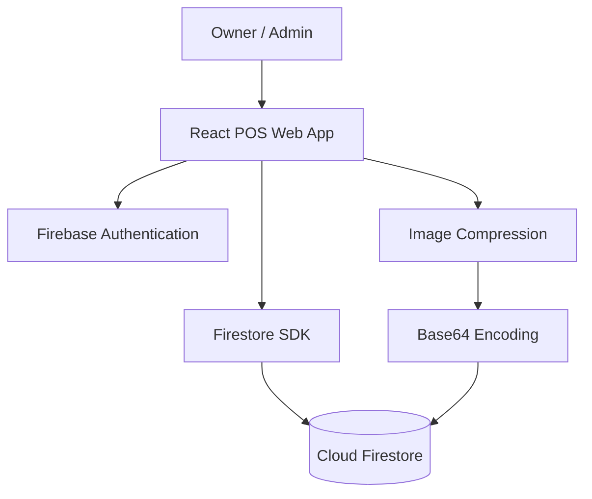
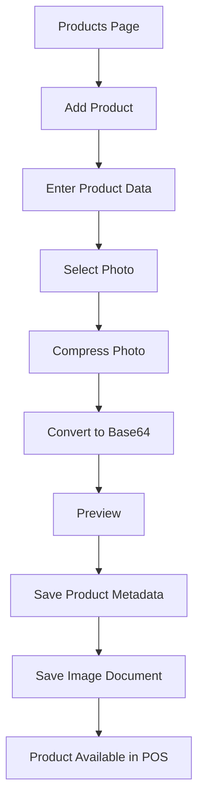
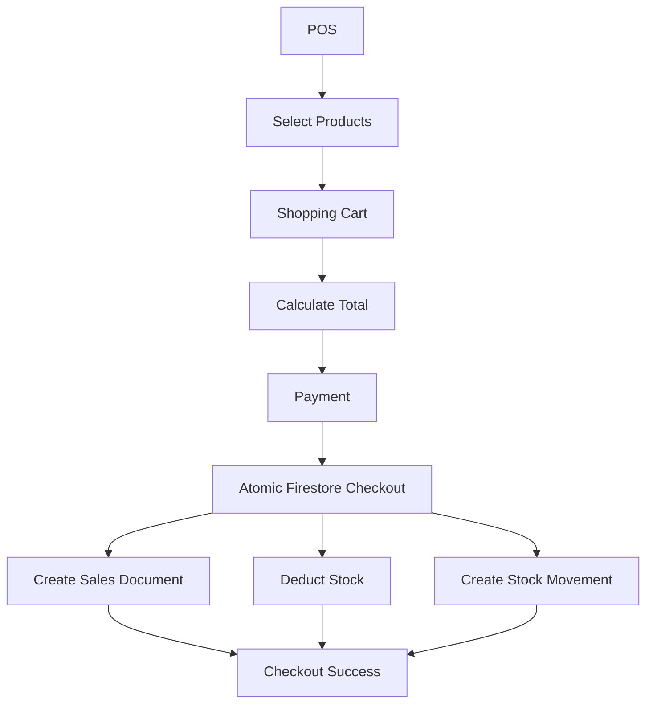
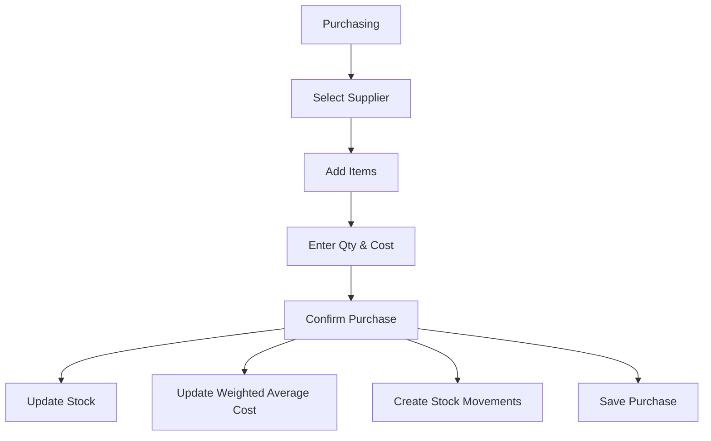

# VOLTRIX PACE POS — System Planning & Technical Specification

> Dokumen perencanaan sistem (baseline) untuk aplikasi Point of Sale dan Inventory Management VOLTRIX PACE. Acuan implementasi developer/AI coding agent.  
> **Status:** Planning / Draft | **Versi:** 1.0 | **Tanggal:** 18 November 2026

---

## 1. Project Overview

### 1.1 Tujuan
Membangun aplikasi POS internal berbasis web untuk operasional VOLTRIX PACE, bisnis komponen elektronik, IoT, robotics, maker, dan tools.

Tujuan:
- Mempercepat transaksi penjualan.
- Memantau dan mengelola stok komponen.
- Mengelola katalog produk, kategori, dan foto.
- Mencatat modal pembelian dan harga jual.
- Mencatat pembayaran tunai dan non-tunai.
- Memantau omzet, gross profit, dan produk terlaris.
- Mengurangi pencatatan manual.

### 1.2 Identitas Proyek

| Item | Detail |
|---|---|
| Project Name | VOLTRIX PACE POS |
| Product Type | Web-based Point of Sale & Inventory Management |
| Frontend | React + Vite |
| Styling | Tailwind CSS |
| Database | Firebase Cloud Firestore |
| Authentication | Firebase Authentication |
| Image Storage | Compressed Base64 in Firestore |
| Hosting | Vercel (planned) |
| Initial User | Owner / single user |
| Architecture | Frontend-only, Firebase SDK |
| Design Direction | Minimal black/white, restrained orange accent |

### 1.3 Prinsip
1. **MVP-first:** prioritaskan fitur inti.
2. **Modular:** pisahkan page, component, service, dan business logic.
3. **Data integrity:** transaksi dan stok harus konsisten.
4. **No silent stock changes:** setiap perubahan stok harus memiliki movement record.
5. **No fabricated business data:** laporan berdasarkan data nyata.
6. **Security-by-rules:** Firebase Security Rules wajib.
7. **Responsive:** desktop, tablet, dan mobile.

---

## 2. Goals & Scope

### 2.1 Goals
- Dashboard operasional.
- Product catalog dan inventory.
- Kasir untuk transaksi penjualan.
- Pembelian dan supplier.
- Riwayat transaksi.
- Laporan penjualan dan profit dasar.

### 2.2 MVP Scope

| Feature | MVP |
|---|:---:|
| Login / Logout | ✓ |
| Dashboard | ✓ |
| Product CRUD | ✓ |
| Category CRUD | ✓ |
| Product Image Compression & Base64 | ✓ |
| POS / Cart / Checkout | ✓ |
| Cash & Non-cash Payment Recording | ✓ |
| Stock Movement | ✓ |
| Purchasing | ✓ |
| Suppliers | ✓ |
| Transaction History | ✓ |
| Receipt | ✓ |
| Basic Reports | ✓ |
| CSV Export | Future |
| Barcode Scanner | Future |
| Multi-cashier | Future |
| Multi-branch | Future |
| Customer Management | Future |
| Accounts Receivable | Future |
| Marketplace Integration | Future |

### 2.3 Future Scope
CSV export/import, barcode scanning, multi-cashier/roles, multi-branch, customer profiles, receivables, Cloud Functions/backend hardening, automatic backups, marketplace integration.

---

## 3. Technology Stack

| Technology | Purpose |
|---|---|
| React | UI and application frontend |
| Vite | Build tool/dev server |
| Tailwind CSS | Styling |
| Firebase Authentication | Authentication |
| Cloud Firestore | Realtime NoSQL database |
| React Router | Navigation |
| Zustand | Global state |
| React Hook Form | Form state |
| Zod | Schema validation |
| Lucide React | Icons |
| Recharts | Charts |
| Vercel | Deployment |

### 3.1 Architecture



Tidak ada Express/Laravel/backend khusus pada MVP. React berkomunikasi langsung dengan Firebase SDK.

> **Security note:** Karena frontend-only, Firebase Security Rules harus dirancang dan diuji dengan ketat. Operasi sensitif dapat dipindahkan ke Cloud Functions/server-side pada tahap berikutnya.

---

## 4. Main Modules

1. Dashboard
2. Product Management
3. Point of Sale (POS)
4. Inventory Management
5. Purchasing
6. Transaction History
7. Reports & Analytics
8. Settings

---

## 5. Functional Requirements

### 5.1 Dashboard
**Summary cards:** omzet hari ini, transaksi hari ini, estimasi gross profit, jumlah produk aktif, stok menipis, stok habis.

**Charts:** penjualan 7 dan 30 hari terakhir, revenue trend, produk terlaris.

**Recent activity:** transaksi terakhir, produk baru, stok masuk terbaru, produk low-stock.

Dashboard menggunakan data Firestore aktual; data mock tidak boleh digunakan di production.

### 5.2 Product Management

#### Product fields

| Field | Type | Description |
|---|---|---|
| `id` | String | Document ID |
| `sku` | String | Unique product code |
| `name` | String | Product name |
| `categoryId` | String | Category reference |
| `description` | String | Product description |
| `capitalPrice` | Number | Current cost per unit |
| `sellingPrice` | Number | Selling price |
| `stock` | Number | Current stock |
| `minStock` | Number | Minimum threshold |
| `unit` | String | pcs, set, pack, meter, etc. |
| `hasImage` | Boolean | Whether image exists |
| `isActive` | Boolean | Active/archive status |
| `createdAt` | Timestamp | Creation time |
| `updatedAt` | Timestamp | Last update time |

**Features:** create, edit, archive, upload/preview/replace photo, search by SKU/name, category and stock filters, sorting by name/price/stock, CSV import/export (future).

### 5.3 Categories
Initial suggestions: Development Board, Sensor, Module, Power Supply, Communication, Robotics, Components, Tools, Starter Kit, Cable & Connector, Other.

Features: create, edit, archive/deactivate, safe deletion/reassignment, list and product count.

### 5.4 Point of Sale (POS)

**Layout:** product catalog, cart (right side desktop), search, category filter, stock indicators, checkout controls.

**Cart features:**
- Add/remove product.
- Edit quantity.
- Quantity cannot exceed available stock.
- Show unit price and line subtotal.
- Optional transaction discount.
- Calculate total, paid amount, and change.
- Validate payment.

**Payment methods:** Cash, QRIS, Transfer, Debit/Other. Payment recorded manually in MVP; no payment gateway.

**Checkout requirements:**
- Revalidate current product status and stock.
- Create sales document.
- Deduct stock.
- Create stock movement.
- Save item-level cost/selling-price snapshots.
- Prevent duplicate checkout.
- Use Firestore atomic transaction or equivalent.
- Avoid partial sale/stock updates on failure.

### 5.5 Inventory Management

| Movement | Meaning |
|---|---|
| `stock_in` | Stock received |
| `stock_out` | Stock removed outside sale |
| `adjustment` | Stock correction |
| `sale` | Stock deducted by sale |
| `return` | Stock returned |

Features: stock-in/out, adjustment with reason, movement history, low/out-of-stock alerts, date filters, stock opname.

Setiap perubahan stok wajib traceable ke movement, actor, timestamp, dan reason/reference.

### 5.6 Purchasing
Fields: purchase number, supplier, date, line items, quantity, unit cost, subtotal, shipping, total, notes, status.

Status: `draft`, `completed`, `cancelled`.

Flow: pilih supplier → tambah produk → qty dan cost → ongkir → review → confirm → stock update → cost update → movements → simpan purchase.

**Costing recommendation:** weighted average cost (rata-rata tertimbang), bukan sekadar mengganti modal dengan harga beli terakhir.

### 5.7 Transaction History
Features: list/search invoice/product, filter date/payment/status, detail, print receipt, export future, void/refund dengan alasan dan authorization.

Transaction item snapshots memastikan perubahan katalog tidak mengubah transaksi historis.

Format invoice: `VPC-YYYYMMDD-XXXX` (contoh `VPC-20261118-0001`).

### 5.8 Reports & Analytics
**Sales:** daily/weekly/monthly/custom revenue, transaction count, AOV, payment method breakdown.  
**Profit:** gross sales, COGS, gross profit, discount, net operational profit estimate (hanya bila biaya operasional tercatat).  
**Products:** best sellers, slow movers, low-stock, inventory asset value, sales by category.

Revenue, gross profit, dan net profit harus dibedakan; omzet tidak boleh disebut keuntungan.

### 5.9 Suppliers
Fields: name, phone, address, notes, active status, created timestamp. Features: add/edit/archive, purchase history.

### 5.10 Settings
Store name, logo, address, WhatsApp, receipt footer, invoice prefix, default minimum-stock, account/profile, app info.

---

## 6. Image Upload & Base64 Storage

### 6.1 Workflow
1. Select image.
2. Validate file type.
3. Validate original size.
4. Decode image in browser.
5. Resize.
6. Compress.
7. Convert to WebP where supported (fallback JPEG).
8. Convert to Base64 Data URL.
9. Preview.
10. Save image to Firestore.

### 6.2 Compression settings

| Setting | Recommendation |
|---|---|
| Input | JPEG, PNG, WebP |
| Maximum original size | 5 MB |
| Output format | WebP preferred |
| Maximum width | 600 px |
| Maximum height | 600 px |
| Quality | 0.70–0.80 |
| Target output size | 50–150 KB |
| Application hard limit | 200 KB |
| Encoding | Base64 Data URL |
| Storage | Firestore |

### 6.3 Firestore size consideration
Firestore document maximum is 1 MiB. Base64 adds roughly one-third overhead, plus document metadata. Enforce compression and output-size limits.

### 6.4 Recommended collection separation

Avoid placing Base64 in the main product documents, since catalog queries would load image payloads.

**`products/{productId}`**
```json
{
  "name": "ESP32 DevKit",
  "sku": "VPC-ESP32-001",
  "capitalPrice": 65000,
  "sellingPrice": 85000,
  "stock": 10,
  "categoryId": "development-board",
  "hasImage": true,
  "isActive": true
}
```

**`product_images/{productId}`**
```json
{
  "productId": "product-id",
  "imageBase64": "data:image/webp;base64,...",
  "mimeType": "image/webp",
  "sizeBytes": 102400,
  "updatedAt": "Timestamp"
}
```

Image is fetched only when needed; implement lazy loading and client cache.

### 6.5 Image service responsibilities
`imageService.js` handles file/type/size validation, decoding, resizing, WebP/JPEG encoding, compression quality, output limit, Base64 conversion, preview, and error states. Keep image processing out of product form components.

---

## 7. Firestore Data Model

### 7.1 Collections

```text
users
products
product_images
categories
sales
stock_movements
purchases
suppliers
settings
```

### 7.2 users
```json
{
  "uid": "firebase-auth-uid",
  "displayName": "Owner",
  "email": "owner@example.com",
  "role": "owner",
  "isActive": true,
  "createdAt": "Timestamp"
}
```
Roles planned: `owner` (full), `admin` (store management), `cashier` (sales). MVP starts owner-only; role expansion later.

### 7.3 products
```json
{
  "sku": "VPC-ESP32-001",
  "name": "ESP32 DevKit V1",
  "description": "ESP32 WiFi Bluetooth development board",
  "categoryId": "development-board",
  "capitalPrice": 65000,
  "sellingPrice": 85000,
  "stock": 10,
  "minStock": 3,
  "unit": "pcs",
  "hasImage": true,
  "isActive": true,
  "createdAt": "Timestamp",
  "updatedAt": "Timestamp"
}
```

### 7.4 product_images
```json
{
  "productId": "product-id",
  "imageBase64": "data:image/webp;base64,...",
  "mimeType": "image/webp",
  "sizeBytes": 102400,
  "updatedAt": "Timestamp"
}
```
Use product ID as image document ID when practical.

### 7.5 categories
```json
{
  "name": "Development Board",
  "description": "Microcontroller development boards",
  "isActive": true,
  "createdAt": "Timestamp",
  "updatedAt": "Timestamp"
}
```

### 7.6 sales
```json
{
  "invoiceNumber": "VPC-20261118-0001",
  "items": [
    {
      "productId": "product-id",
      "sku": "VPC-ESP32-001",
      "name": "ESP32 DevKit V1",
      "qty": 2,
      "capitalPrice": 65000,
      "sellingPrice": 85000,
      "subtotal": 170000
    }
  ],
  "subtotal": 170000,
  "discount": 0,
  "total": 170000,
  "paidAmount": 200000,
  "changeAmount": 30000,
  "paymentMethod": "cash",
  "totalCost": 130000,
  "grossProfit": 40000,
  "status": "completed",
  "soldAt": "Timestamp",
  "createdBy": "uid"
}
```

### 7.7 stock_movements
```json
{
  "productId": "product-id",
  "productName": "ESP32 DevKit V1",
  "type": "stock_in",
  "qty": 10,
  "beforeStock": 5,
  "afterStock": 15,
  "referenceId": "purchase-id",
  "note": "Restock supplier",
  "createdAt": "Timestamp",
  "createdBy": "uid"
}
```

### 7.8 purchases
```json
{
  "purchaseNumber": "VPC-PUR-20261118-0001",
  "supplierId": "supplier-id",
  "items": [
    {
      "productId": "product-id",
      "name": "ESP32 DevKit V1",
      "qty": 10,
      "unitCost": 65000,
      "subtotal": 650000
    }
  ],
  "subtotal": 650000,
  "shippingCost": 15000,
  "total": 665000,
  "status": "completed",
  "purchasedAt": "Timestamp",
  "createdAt": "Timestamp",
  "createdBy": "uid"
}
```

### 7.9 suppliers
```json
{
  "name": "Supplier Elektronik",
  "phone": "",
  "address": "",
  "notes": "",
  "isActive": true,
  "createdAt": "Timestamp",
  "updatedAt": "Timestamp"
}
```

### 7.10 settings
Store-level configuration: name, logo reference, address, WhatsApp, receipt footer, invoice prefix, default stock threshold. Do not put privileged secrets here.

---

## 8. System Flows

### 8.1 Product Creation


### 8.2 Sale / Checkout


### 8.3 Purchasing / Restock


### 8.4 Void / Refund
1. Owner opens completed transaction.
2. Select void/refund action.
3. Enter reason.
4. System validates transaction status.
5. Update transaction status.
6. Record stock reversal if applicable.
7. Preserve original transaction and audit history.

Do not silently delete transactions.

---

## 9. Security & Validation

### 9.1 Authentication
- Firebase email/password.
- Public registration disabled.
- Owner account created manually.
- Protected routes.
- Session persistence.
- Logout.
- Validate user status.

### 9.2 Firestore Security Rules
Rules must enforce authenticated access, roles, permissions, prevent self-role modification, restrict public access, and protect cost/profit/settings data.

### 9.3 Product Validation
- SKU required and unique.
- Name required.
- Prices non-negative.
- Stock non-negative.
- Unit required.
- Category valid.
- Image type and size validated.
- Archived products cannot be sold.

### 9.4 Checkout Validation
- Quantity positive.
- Stock sufficient.
- Product active.
- Payment valid.
- Method valid.
- No duplicate checkout.
- Completed transaction cannot be processed again.
- Sale and stock records remain consistent.

### 9.5 Stock Integrity
Every movement must record actor, timestamp, product, movement type, quantity, before/after stock, reason, and reference when applicable.

---

## 10. UI/UX & Design System

### 10.1 Visual Direction
Minimal, technical, modern, premium but approachable. Black/white base and restrained orange accent, consistent with VOLTRIX PACE identity.

### 10.2 Color Tokens

| Token | Value | Usage |
|---|---|---|
| Primary | `#111111` | Sidebar/header/main UI |
| Background | `#F5F6F8` | Page background |
| Surface | `#FFFFFF` | Cards, tables, modal |
| Accent | `#FF6B00` | Main actions/highlights |
| Text | `#222222` | Primary text |
| Muted | `#8A8A8A` | Secondary text |
| Border | `#E7E7E7` | Borders/dividers |
| Success | Green token | Completed |
| Warning | Amber token | Low stock |
| Danger | Red token | Out-of-stock/error |

### 10.3 Layout

**Desktop:** sidebar, topbar, main content, data tables, modal/drawer.

**Mobile:** drawer navigation, optional bottom nav, responsive POS, sticky checkout, table-to-card adaptation.

### 10.4 Sidebar
Dashboard, Point of Sale, Products, Categories, Inventory, Purchases, Suppliers, Transactions, Reports, Settings.

---

## 11. React Project Structure

```text
voltrix-pace-pos/
├── public/
│   ├── logo.svg
│   └── favicon.svg
├── src/
│   ├── assets/
│   ├── components/
│   │   ├── ui/
│   │   ├── layout/
│   │   ├── tables/
│   │   ├── forms/
│   │   └── common/
│   ├── layouts/
│   │   ├── DashboardLayout.jsx
│   │   └── AuthLayout.jsx
│   ├── pages/
│   │   ├── Dashboard/
│   │   ├── POS/
│   │   ├── Products/
│   │   ├── Categories/
│   │   ├── Inventory/
│   │   ├── Purchases/
│   │   ├── Suppliers/
│   │   ├── Transactions/
│   │   ├── Reports/
│   │   ├── Settings/
│   │   └── Login/
│   ├── features/
│   │   ├── product/
│   │   ├── sales/
│   │   ├── inventory/
│   │   ├── purchasing/
│   │   └── reports/
│   ├── hooks/
│   ├── services/
│   │   ├── firebase/
│   │   │   ├── config.js
│   │   │   ├── auth.js
│   │   │   └── firestore.js
│   │   ├── productService.js
│   │   ├── salesService.js
│   │   ├── inventoryService.js
│   │   ├── purchaseService.js
│   │   └── imageService.js
│   ├── stores/
│   ├── utils/
│   ├── constants/
│   ├── routes/
│   └── App.jsx
├── firestore.rules
├── .env
└── package.json
```

### 11.1 Responsibilities

| Directory | Responsibility |
|---|---|
| `pages` | Route-level pages |
| `components` | Reusable UI |
| `features` | Domain/business logic |
| `services` | Firebase communication |
| `stores` | Global state |
| `hooks` | Reusable hooks |
| `utils` | Helpers/formatters |
| `constants` | Enums/fixed values |

---

## 12. Development Phases

### Phase 1 — Foundation
- React + Vite.
- Tailwind.
- Firebase setup.
- Authentication.
- Protected routes.
- Dashboard layout.
- Sidebar/navigation.
- VOLTRIX design system.

**Deliverable:** app skeleton, working login and navigation.

### Phase 2 — Product & Catalog
- Product CRUD.
- Category CRUD.
- Image upload.
- Compression.
- Base64 storage.
- SKU.
- Search/filter.
- Stock indicators.

**Deliverable:** Firestore-backed catalog.

### Phase 3 — POS Core
- Product selection.
- Shopping cart.
- Quantity.
- Discount.
- Payment.
- Checkout.
- Atomic stock deduction.
- Receipt.

**Deliverable:** working sale flow.

### Phase 4 — Inventory & Purchasing
- Stock movements.
- Restock.
- Suppliers.
- Purchase transactions.
- Weighted average cost.
- Stock adjustment.
- Low-stock notifications.

**Deliverable:** inventory/purchasing module.

### Phase 5 — Transactions & Reports
- Transaction history/detail.
- Void/refund.
- Daily/monthly reports.
- Gross profit.
- Product ranking.
- CSV export (if included).

**Deliverable:** operational reporting.

### Phase 6 — Polish & Deployment
- Responsive UI.
- Loading/empty states.
- Error handling.
- Security Rules audit.
- Performance.
- Vercel deployment.
- Backup/export strategy.

**Deliverable:** MVP ready for operational testing.

---

## 13. Acceptance Criteria

### Authentication
- [ ] Owner can login/logout.
- [ ] Unauthenticated users cannot access protected pages.
- [ ] Session persistence works.

### Product
- [ ] Products can be created, edited, archived.
- [ ] Image compression and Base64 storage works.
- [ ] SKU uniqueness enforced.
- [ ] Stock and prices editable.

### POS
- [ ] Search/select products.
- [ ] Edit cart quantity.
- [ ] Stock validation.
- [ ] Correct subtotal, discount, total, paid, change.
- [ ] Atomic checkout.
- [ ] Stock deducted exactly once.
- [ ] Receipt display/print.

### Inventory
- [ ] Stock in/out/adjustment recorded.
- [ ] Adjustment requires reason.
- [ ] Movement history visible.
- [ ] Low-stock detection.

### Purchasing
- [ ] Supplier and purchase items captured.
- [ ] Quantity, cost, shipping captured.
- [ ] Stock updated on completed purchase.
- [ ] Costing method implemented as agreed.

### Reports
- [ ] Daily/monthly sales.
- [ ] Gross profit from snapshots.
- [ ] Date filters.
- [ ] Best-selling products.

### Technical
- [ ] Firestore Rules deployed.
- [ ] No privileged secrets in frontend.
- [ ] Responsive UI.
- [ ] Loading/error/empty states.
- [ ] Backup/export documented.

---

## 14. Suggested Dependencies

```bash
npm create vite@latest voltrix-pace-pos -- --template react
cd voltrix-pace-pos

npm install firebase react-router-dom zustand
npm install react-hook-form zod @hookform/resolvers
npm install lucide-react recharts
npm install -D tailwindcss @tailwindcss/vite
```

Check compatible current versions when implementing.

---

## 15. Environment Variables

Create `.env`:

```env
VITE_FIREBASE_API_KEY=
VITE_FIREBASE_AUTH_DOMAIN=
VITE_FIREBASE_PROJECT_ID=
VITE_FIREBASE_STORAGE_BUCKET=
VITE_FIREBASE_MESSAGING_SENDER_ID=
VITE_FIREBASE_APP_ID=
```

Firebase web config is not a privileged secret, but access is controlled by Firebase Auth and Security Rules. Never expose service-account credentials/private server keys in frontend environment variables.

---

## 16. Deployment Plan

### Vercel
1. Push project to Git.
2. Import repository to Vercel.
3. Configure `VITE_FIREBASE_*` environment variables.
4. Build and deploy.
5. Configure SPA rewrite for React Router.
6. Verify auth and Firestore permissions.
7. Test desktop and mobile.
8. Set production domain when ready.

### Post-deployment checklist
- Authentication works.
- Security Rules work in production.
- Firestore access is authorized.
- Image compression/storage works.
- Checkout atomicity works.
- Receipt printing works.
- Responsive UI verified.
- Config is correct and no unintended secrets are exposed.

---

## 17. Risks & Mitigation

| Risk | Impact | Mitigation |
|---|---|---|
| Base64 images increase document size | Firestore limits/bandwidth | Compress, cap, separate image collection |
| Frontend checkout logic | Race conditions/manipulation | Atomic transaction, strict rules; server-side later |
| Stock without movement history | Difficult auditing | Mandatory movement records |
| Slow-moving stock | Capital tied up | Low initial quantities, demand validation, preorder |
| Supplier price changes | Margin instability | Weighted-average costing, periodic price review |
| Duplicate checkout | Duplicate sales/stock deduction | Idempotency guard, atomic transaction |
| Quota/cost growth | Operational disruption | Monitor usage, query efficiently, cache |
| Unauthorized access | Data exposure | Auth, least-privilege rules, no public writes |

---

## 18. Business Metrics / KPIs

- Daily revenue.
- Monthly revenue.
- Transaction count.
- Average transaction value.
- Gross profit.
- Gross margin.
- Top 10 products.
- Slow-moving inventory.
- Low-stock count.
- Inventory value.
- Purchase expenditure.

**Definitions:**
- Revenue: sales total according to the report's agreed definition.
- COGS: cost of goods sold.
- Gross profit: revenue minus COGS.
- Gross margin: gross profit divided by revenue.
- Inventory value: quantity × applicable inventory cost.

Metrics must derive from transaction snapshots and inventory records, not only current catalog prices.

---

## 19. Owner Decisions / TODO

- [ ] Finalize store profile and receipt info.
- [ ] Decide invoice prefix.
- [ ] Confirm SKU convention.
- [ ] Confirm category list.
- [ ] Confirm payment methods.
- [ ] Confirm discount policy.
- [ ] Confirm void/refund policy.
- [ ] Confirm weighted-average cost implementation.
- [ ] Confirm purchasing/reporting MVP scope.
- [ ] Create Firebase project.
- [ ] Create owner account.
- [ ] Configure required Firestore indexes.
- [ ] Finalize Security Rules.
- [ ] Prepare logo asset (SVG preferred).

---

## 20. Final System Baseline

| Area | Decision |
|---|---|
| Frontend | React + Vite |
| Language | JavaScript |
| Styling | Tailwind CSS |
| Database | Cloud Firestore |
| Authentication | Firebase Authentication |
| Images | Client compression → WebP → Base64 → Firestore |
| Image documents | Separate `product_images` collection |
| Routing | React Router |
| State | Zustand |
| Forms | React Hook Form + Zod |
| Icons | Lucide React |
| Charts | Recharts |
| Hosting | Vercel |
| Initial user | Owner-first MVP |
| Stock tracking | Movement-based |
| Checkout | Atomic Firestore operation |
| Costing | Weighted average |
| Design | VOLTRIX black/white, restrained orange accent |
| Deployment | Vercel |

> **Implementation principle:** Build incrementally, test each phase, and do not proceed until the current phase meets its acceptance criteria.
